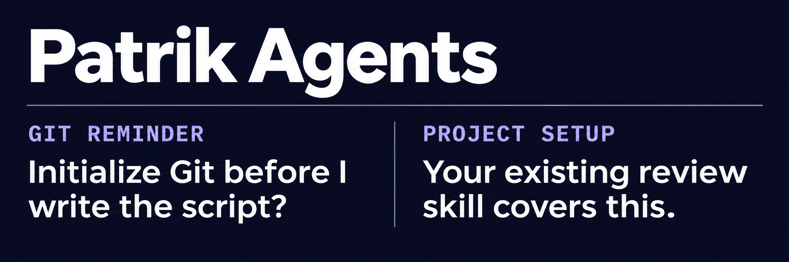

# 

Six optional plugins for Claude Code and Codex. Choose the ones you want. Updating an existing install keeps that selection.

## Choose what to enable

| Plugin | When to use it |
| --- | --- |
| [Project Map](plugins/project-map/skills/project-map/SKILL.md) | Track the branches of a project as a chat moves between them. Ask for the map or just a one-line bookmark when handing work off. |
| [Project Setup](plugins/project-setup/skills/project-setup/SKILL.md) | See which skills already cover your task, or review a prompt or instruction against what actually happened. |
| [Guidance Research](plugins/research-agent-guidance/skills/research-agent-guidance/SKILL.md) | Check first-party agent guidance and record dated sources in your project. |
| [Guidance Consolidation](plugins/consolidate-agent-guidance/skills/consolidate-agent-guidance/SKILL.md) | Use evidence to propose a specific edit to your guide. Apply it when requested. |
| [Repository Cleanup](plugins/repo-cleanup/skills/repo-cleanup/SKILL.md) | Trace a stale instruction or broken documentation link to its owner and preview a correction. |
| [Git Reminder](plugins/git-reminder/hooks/hooks.json) | Keep notes quiet and ask about Git before the first code edit outside a repository. |

## Install

These commands install **Project Map**. To select another plugin, substitute its [catalog name](docs/install.md#plugin-names).

**Claude Code**

```sh
claude plugin install project-map --marketplace smrik/patrik-agents --scope user
```

**Codex**

```sh
codex plugin marketplace add smrik/patrik-agents
codex plugin add project-map@patrik-agents
```

Only Git Reminder installs a startup hook. It needs Node.js and Git. If you select Git Reminder in Codex, review and trust that hook. Open a fresh chat to use it.

[Desktop installation](docs/install.md#desktop) · [Try the plugins](docs/install.md#try-it) · [Full installation guide](docs/install.md)
